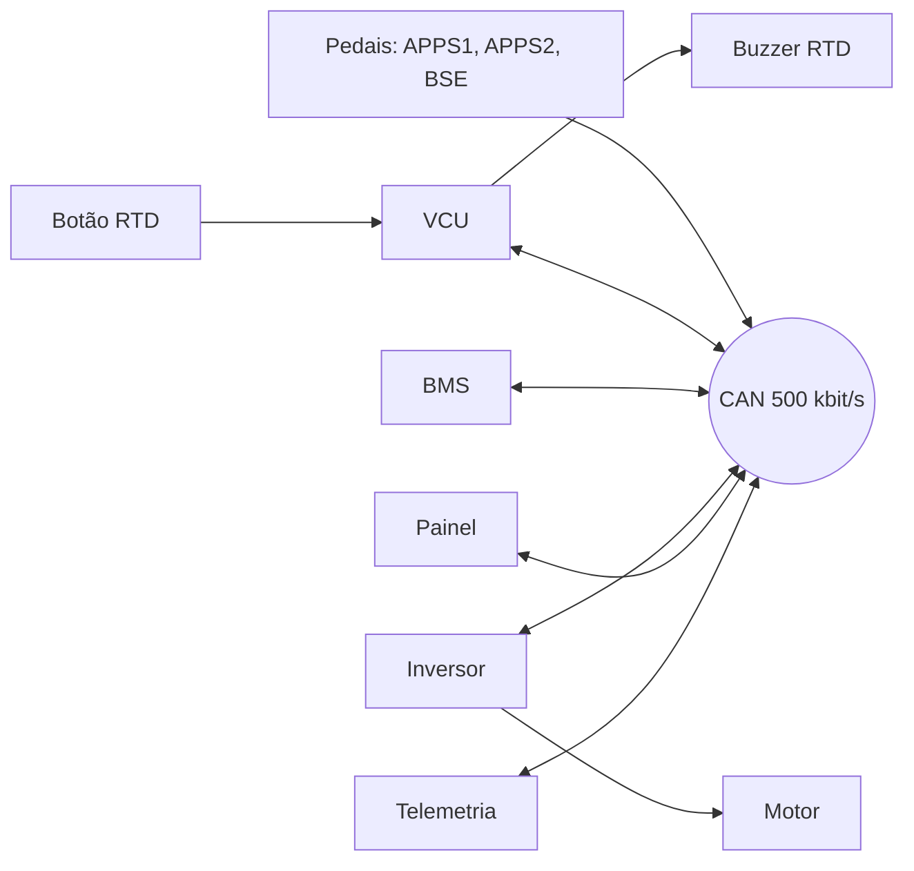
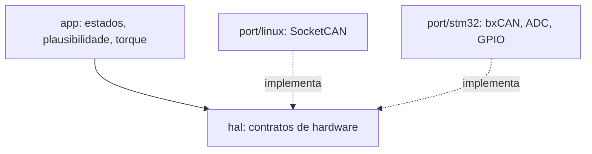

# Arquitetura

## Rede CAN do carro

Na simulação os pedais chegam pela rede CAN, como se houvesse uma placa de sensores na frente do carro. No carro real eles podem ser lidos direto pelo ADC da VCU. A camada HAL esconde essa diferença. A taxa de 500 kbit/s é provisória e será definida com a equipe.

## Camadas do firmware da VCU

| Camada | Pasta | Responsabilidade |
|---|---|---|
| Aplicação | `vcu/app` | Máquina de estados, plausibilidade APPS/BSE, cálculo de torque. Não conhece hardware. |
| HAL | `vcu/hal` | Arquivos `.h` com os contratos: enviar/receber CAN, ler ADC, GPIO, tempo. |
| Port Linux | `vcu/port/linux` | Implementa a HAL no PC com SocketCAN. |
| Port STM32 | `vcu/port/stm32` | Implementa a HAL no microcontrolador. |

## Fases de simulação

1. PC: VCU (port Linux) + simuladores Python no `vcan0`.
2. Wokwi: entradas e saídas da placa (pedal analógico, botão RTD, buzzer).
3. Renode: firmware STM32 completo com CAN.
4. Bancada: placa real ligada a um barramento CAN físico.
